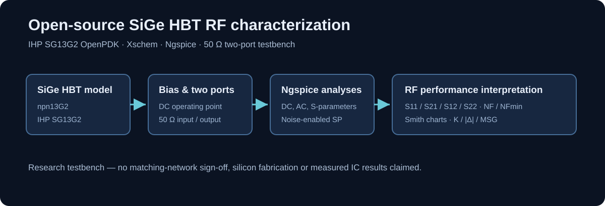
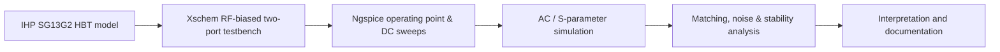

# SiGe HBT RF Characterization with IHP SG13G2 OpenPDK

**DC, small-signal, S-parameter, noise and stability analysis of an RF-biased SiGe heterojunction bipolar transistor (HBT)** using an open-source EDA workflow.

**Context:** Summer 2026 research internship at Karlsruhe Institute of Technology (KIT)  
**Researcher:** Ece Ceyla Demir · Electrical and Electronics Engineering, Middle East Technical University (METU)  
**Technology:** IHP SG13G2 OpenPDK, `npn13G2` HBT  
**Tools:** Xschem, Ngspice, IIC-OSIC-TOOLS, Docker, Ubuntu

> **Status:** Research characterization testbench, **not** a fabricated chip or a finished impedance-matched/stabilized RF amplifier. The repository is currently private pending a publication and sharing review.

## Overview

This work explores a reproducible open-source flow for the **device-to-RF characterization** of a SiGe HBT. Starting with a biased 50 Ω two-port testbench, the workflow connects transistor operating-point behavior to gain, reflection, noise and stability metrics used in RFIC design.

The work covers:
- DC sweeps: collector current versus base-emitter and collector-emitter voltages.
- Small-signal AC response and gain roll-off.
- Two-port **S11, S21, S12, S22** analyses with 50 Ω reference ports.
- Smith-chart interpretation and S-, Y-, Z-parameter representations.
- Noise figure (**NF**), minimum noise figure (**NFmin**), equivalent noise resistance (**Rn**), and optimum source reflection coefficient (**Sopt**).
- Post-processing of **Rollett stability factor K**, `|Δ|` and maximum stable gain (**MSG**) from S-parameters.

## Analysis flow

The schematic uses an `npn13G2` device with RF input/output ports, coupling capacitors, and bias inductors. The passive values in this early testbench are highly idealized. The study is intended to **characterize the device and establish a simulation workflow**, rather than present a physically realizable matching network.

## Selected findings

| Analysis | Observation recorded in internship report | Interpretation |
| --- | --- | --- |
| DC (I_C)–(V_{BE}) | Collector current rises sharply with base-emitter bias | Expected HBT turn-on behavior |
| DC (I_C)–(V_{CE}) | Output-characteristic family varies with base bias | Operating-point sensitivity |
| AC response | Strong low/mid-frequency response with high-frequency roll-off | Finite device speed and parasitics |
| S-parameters | Approximately 20 dB reported forward transmission over part of the sweep; poor 50 Ω input/output matching | Gain **does not** imply matching |
| Noise | Approximately 1.5 dB NF and 0.5 dB NFmin reported in the lower-frequency region | Noise-optimum source differs from 50 Ω |
| Stability | K below 1 over a substantial region of the simulated sweep | **Unconditional stability was not established**; MSG used rather than assuming Gmax everywhere |

These are **reported simulation observations**, not laboratory measurements. Approximate values depend on testbench, bias and frequency. No silicon validation is claimed.

## Repository guide

- [Simulation netlist](simulations/S1_npn13G2_RF_Biased_Testbench.spice) — preserved snapshot supplied from the internship.
- [Technical methodology](docs/methodology.md) — what each analysis does, and why.
- [Results and interpretation](docs/results.md) — scope and documented observations.
- [Reproducibility notes](docs/reproducibility.md) — PDK dependencies, simulator setup and known differences between artifacts.
- [Publication checklist](docs/publication-checklist.md) — what is confirmed and what needs review before releasing the repository publicly.

## Reproducing the testbench

1. Install and configure the **IHP SG13G2 OpenPDK** with Ngspice and, for schematic-level work, Xschem. The original environment used Ubuntu 24.04, Docker and IIC-OSIC-TOOLS.
2. Open the provided [netlist](simulations/S1_npn13G2_RF_Biased_Testbench.spice).
3. Update the local `.lib` path to your SG13G2 HBT model library. The original path is environment-specific.
4. Run the simulation in an Ngspice build supporting the necessary two-port `sp` analysis and its optional noise calculation.
5. Inspect `S11/S21/S12/S22`, K, `|Δ|`, MSG and the operating point. See the reproducibility notes **before** comparing numerical results.

**Important:** The supplied SPICE snapshot sets `V2 = 0.85 V` and `V4 = 1.2 V`, whereas the working report describes `V2 = 0.8 V` and `V4 = 2 V` for several RF analyses. Therefore, the snapshot must **not** be claimed to exactly reproduce every figure in the report without restoring the corresponding settings and rerunning the simulations.

## Limitations and next steps

- No custom RF matching network or stabilization network was finalized in this stage.
- The 1 MHz–500 GHz setup is a numerical sweep range; it is **not** a claim of useful operation or validated model accuracy throughout that range.
- Large ideal coupling capacitors and RF chokes simplify the testbench, rather than represent final integrated passives.
- Layout, parasitic extraction, EM verification and tape-out are **not** demonstrated by the uploaded testbench.
- Before publishing, add validated run configurations and original plots with explicit frequency and bias annotations.

## Attribution

This repository documents work associated with Ece Ceyla Demir's 2026 research internship at KIT. The IHP SG13G2 technology files and third-party EDA tools are **not redistributed here**; obtain them from their official sources and observe their licenses. Publication of institutional research artifacts is subject to the applicable supervisor/institution permissions.

**License:** No public redistribution license is granted at this stage.
