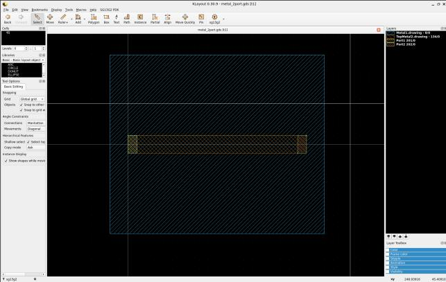
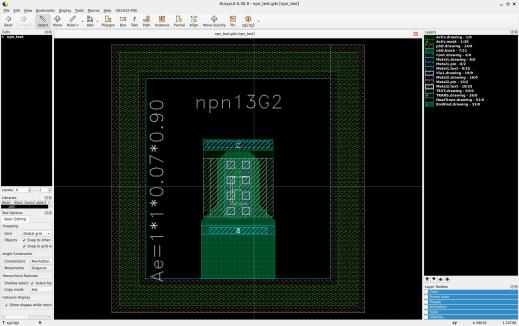
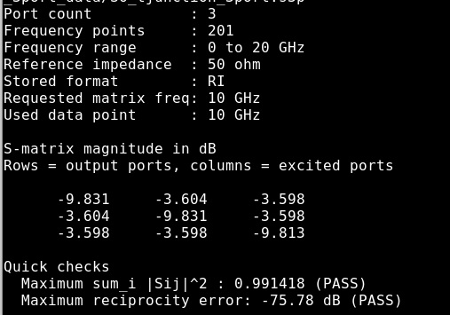
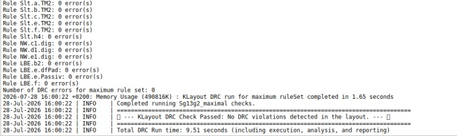
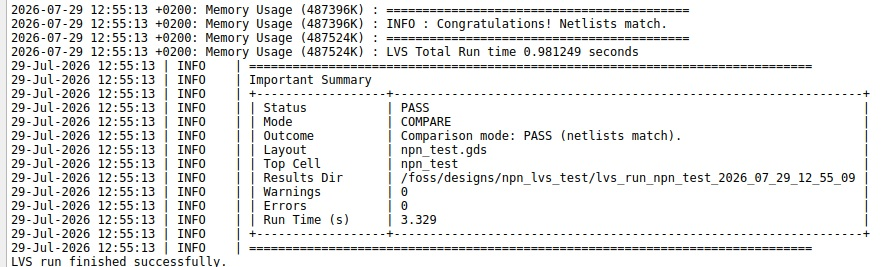

# Open-Source RFIC Characterization and EM Verification with IHP SG13G2

**Circuit-level SiGe HBT characterization and layout-based electromagnetic verification** using an open-source IHP SG13G2 flow.


**Context:** Summer 2026 research internship at Karlsruhe Institute of Technology (KIT)  
**Researcher:** Ece Ceyla Demir · Electrical and Electronics Engineering, Middle East Technical University (METU)  
**Technology:** IHP SG13G2 OpenPDK, `npn13G2` HBT  
**Tools:** Xschem, Ngspice, KLayout, AppCSXCAD, openEMS, IIC-OSIC-TOOLS, Docker, Ubuntu

> **Status:** Research characterization testbench, **not** a fabricated chip or a finished impedance-matched/stabilized RF amplifier. The repository is currently private pending a publication and sharing review.

## Overview

This work documents two linked phases of a 2026 KIT internship: (1) SiGe HBT device-level RF characterization using Xschem/Ngspice and (2) GDSII-based passive-structure EM simulation with KLayout, AppCSXCAD and openEMS. The broader original IEEE-style report, including captured simulation plots, is provided below.

The work covers:
- DC sweeps: collector current versus base-emitter and collector-emitter voltages.
- Small-signal AC response and gain roll-off.
- Two-port **S11, S21, S12, S22** analyses with 50 Ω reference ports.
- Smith-chart interpretation and S-, Y-, Z-parameter representations.
- Noise figure (**NF**), minimum noise figure (**NFmin**), equivalent noise resistance (**Rn**), and optimum source reflection coefficient (**Sopt**).
- Post-processing of **Rollett stability factor K**, `|Δ|` and maximum stable gain (**MSG**) from S-parameters.
- **Ready-made GSG line**: example-based openEMS flow validation; S11/S21 and impedance results for 8–12 GHz.
- **Custom Metal1–TopMetal2 line**: 200 µm × 20 µm signal strip over a 240 µm × 200 µm ground plane; two-port EM analysis.
- **Three-port T-junction**: port-detection workflow adapted from an existing generic N-port script; S-matrix, passivity and reciprocity checks.
- **DRC/LVS verification**: IHP SG13G2 npn13G2 PCell test layout; zero reported DRC violations and an LVS match after a compatible netlist was prepared.

## Analysis flow


The schematic uses an `npn13G2` device with RF input/output ports, coupling capacitors, and bias inductors. The passive values in this early testbench are highly idealized. The study is intended to **characterize the device and establish a simulation workflow**, rather than present a physically realizable matching network.

## Original internship reports and plotted evidence

- **[Full internship report: circuit and EM verification (PDF, 9 pages)](docs/Ceyla_RFIC_IEEE_Two_Column_Report.pdf)** — primary project overview, original simulation plots and figure screenshots. Includes SiGe HBT, GSG/EM line, custom T-junction and DRC/LVS.
- **[IIC-OSIC-TOOLS installation and localhost guide (PDF, 14 pages)](docs/IIC_OSIC_TOOLS_Installation_and_Localhost_Guide.pdf)** — Ubuntu/Windows setup, Docker, noVNC, persistent storage, and PDK/tool verification.
- [Detailed RF characterization notes](docs/methodology.md) and [selected results](docs/results.md).

**Evidence provenance:** The graphs and screenshots in these PDFs come from the supplied internship documents. The attached text-based RF testbench represents only **one** configuration; independent model runs and full openEMS project source trees have not been repackaged into this repository.

## Original report figures (archived evidence)

The following three images were extracted **directly from the original 9-page IEEE-style internship PDF**; they are not generated by the reconstructed scripts in this repository.

| Custom Metal1–TopMetal2 line | Three-port T-junction | Single-HBT layout |
| :--: | :--: | :--: |
|  |  |  |

### Original EM/verification plots from the report

| Custom line S11 | Custom line S21 | T-junction full S-matrix |
| :--: | :--: | :--: |
|  |  |  |



<details><summary>Additional original verification screenshots</summary>




</details>

See [figure provenance and limitations](docs/figure-provenance.md). Numeric simulation plots, full verification logs and results remain in the [original report PDF](docs/Ceyla_RFIC_IEEE_Two_Column_Report.pdf).

## EM results and physical verification

| Test structure | Selected documented result | Scope |
| --- | --- | --- |
| Ready GSG line (reference example) | At 10 GHz: **S11 −35.00 dB**, **S21 −0.016 dB** | Verification of an existing openEMS workflow, **not** claimed as an original layout |
| Custom Metal1–TopMetal2 line | At 10 GHz: **S11 ≈ −36 dB**, **S21 ≈ −0.045 dB** | Custom geometry; report presents Port-1 excitation |
| Custom T-junction | ~−3.60 dB transmission branches and ~−9.8 dB reflections in a documented example point | Three-port Touchstone extraction, passivity/reciprocity checks; original example script adapted |
| npn13G2 PCell | Reported **0 DRC violations** and successful LVS match | Single-device verification, not a complete IC layout signoff |

The report explicitly notes that a full independent two-port S-matrix for the custom metal line would require exciting Port 2 as well; mesh-convergence analysis was also left for further work.

## Selected findings

| Analysis | Observation recorded in internship report | Interpretation |
| --- | --- | --- |
| DC (I_C)–(V_{BE}) | Collector current rises sharply with base-emitter bias | Expected HBT turn-on behavior |
| DC (I_C)–(V_{CE}) | Output-characteristic family varies with base bias | Operating-point sensitivity |
| AC response | Strong low/mid-frequency response with high-frequency roll-off | Finite device speed and parasitics |
| S-parameters | Approximately 20 dB reported forward transmission over part of the sweep; poor 50 Ω input/output matching | Gain **does not** imply matching |
| Noise | Approximately 1.5 dB NF and 0.5 dB NFmin reported in the lower-frequency region | Noise-optimum source differs from 50 Ω |
| Stability | K below 1 over a substantial region of the simulated sweep | **Unconditional stability was not established**; MSG used rather than assuming Gmax everywhere |

These are **reported simulation observations**, not laboratory measurements. Approximate values depend on testbench, bias and frequency. No silicon validation is claimed.

## Repository guide

- [Simulation netlist](simulations/S1_npn13G2_RF_Biased_Testbench.spice) — preserved snapshot supplied from the internship.
- [Original full KIT internship report](docs/Ceyla_RFIC_IEEE_Two_Column_Report.pdf) — circuit, EM and layout evidence.
- [Installation and localhost guide](docs/IIC_OSIC_TOOLS_Installation_and_Localhost_Guide.pdf) — Docker/noVNC setup.
- [Technical methodology](docs/methodology.md) — what each analysis does, and why.
- [Results and interpretation](docs/results.md) — scope and documented observations.
- [Reproducibility notes](docs/reproducibility.md) — PDK dependencies, simulator setup and known differences between artifacts.
- [Publication checklist](docs/publication-checklist.md) — what is confirmed and what needs review before releasing the repository publicly.

## Reproducibility at a glance

For a reviewer-friendly distinction between the **original 2026 simulations** and the **reconstructed 2026 tooling**, see the [verification and evidence matrix](docs/verification-matrix.md).

The Touchstone analyzer includes a runnable **synthetic-only** 2-port input, so it can be demonstrated without fabricating the missing original `.s2p`:

```bash
python scripts/analyze_touchstone.py examples/synthetic_two_port_TEST_ONLY.s2p --freq-ghz 10
```

The example S-parameters are arbitrary parser-test data, **not** internship results. Historical results remain in the original report PDF.

## Reconstructed analysis and layout helpers

The following are **newly written reference utilities (November 2026), not the original KIT internship Python sources**:

- [Touchstone N-port parser, plots and checks](scripts/analyze_touchstone.py) (RI/MA/DB, passivity, reciprocity, phase and CSV/JSON output).
- [Automatic N-port marker detection and sequential openEMS runner](scripts/run_auto_nport_interactive.py).
- [Parametric GDS generator](scripts/generate_gds_examples.py) based on the report's layer numbers and documented 2-port dimensions.
- [openEMS driver contract](scripts/openems_model_driver.template.py). A real run **requires the original verified SG13G2 material stack / geometry importer**, and cannot be performed from the PDF alone.
- [Python unit tests](tests/test_touchstone.py) and [setup/reconstruction notes](docs/reconstructed-tools.md).
- [Transcribed X-band result table](data/reported_custom_line_xband.csv) with original-source attribution, **not** re-simulated numbers or a full measured Touchstone sweep.

```bash
python -m pip install numpy matplotlib
python scripts/analyze_touchstone.py path/to/your.s3p --freq-ghz 10
python -m unittest discover -s tests -v
# GDS generation requires the optional gdstk package
python scripts/generate_gds_examples.py --out-dir generated_gds
# Marker discovery only (no EM results):
python scripts/run_auto_nport_interactive.py generated_gds/metal_2port_reconstructed.gds --dry-run
```

**The original** `S2_GSG_sim.s2p`, `metal_2port.gds` and the historical openEMS driver have not been recovered. Numerical matches to the report are **not claimed** for these fresh reconstructions.

### Reconstructed GDS examples

- [Downloadable 2-port line GDS](layout_examples/metal_2port_reconstructed.gds) — geometries and layers from Table V of the original report.
- [Downloadable illustrative 3-port T-junction GDS](layout_examples/t_junction_illustrative.gds) — layer assignment from the original report; **T-arm dimensions are illustrative because the original sizes were not archived**.

These are **newly generated layout files, not original recovered GDSII**. They have not undergone SG13G2 DRC/LVS or an EM run. The Python generator can recreate their geometry; verify any subsequent output in KLayout against the actual PDK before using in a semiconductor flow.

## Reproducing the testbench

1. Install and configure the **IHP SG13G2 OpenPDK** with Ngspice and, for schematic-level work, Xschem. The original environment used Ubuntu 24.04, Docker and IIC-OSIC-TOOLS.
2. Open the provided [netlist](simulations/S1_npn13G2_RF_Biased_Testbench.spice).
3. Update the local `.lib` path to your SG13G2 HBT model library. The original path is environment-specific.
4. Run the simulation in an Ngspice build supporting the necessary two-port `sp` analysis and its optional noise calculation.
5. Inspect `S11/S21/S12/S22`, K, `|Δ|`, MSG and the operating point. See the reproducibility notes **before** comparing numerical results.

**Important:** The supplied SPICE snapshot sets `V2 = 0.85 V` and `V4 = 1.2 V`, whereas the working report describes `V2 = 0.8 V` and `V4 = 2 V` for several RF analyses. Therefore, the snapshot must **not** be claimed to exactly reproduce every figure in the report without restoring the corresponding settings and rerunning the simulations.

## Limitations and next steps

- No custom RF matching network or stabilization network was finalized in this stage.
- The 1 MHz–500 GHz setup is a numerical sweep range; it is **not** a claim of useful operation or validated model accuracy throughout that range.
- Large ideal coupling capacitors and RF chokes simplify the testbench, rather than represent final integrated passives.
- Layout-based EM **is documented separately** in the internship PDF, but the original GDSII, FDTD meshes and Touchstone files are not yet supplied as standalone repository artifacts. Tape-out and measured silicon are **not** claimed.
- Before publishing, add validated run configurations and original plots with explicit frequency and bias annotations.

## Attribution

This repository documents work associated with Ece Ceyla Demir's 2026 research internship at KIT. The installation guide and IEEE-style report were provided by the researcher; see those documents for original references. The IHP SG13G2 technology files and third-party EDA tools are **not redistributed here**; obtain them from their official sources and observe their licenses. Publication of institutional research artifacts is subject to the applicable supervisor/institution permissions.

**License:** No public redistribution license is granted at this stage.
