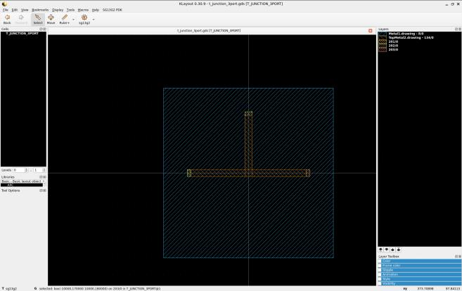
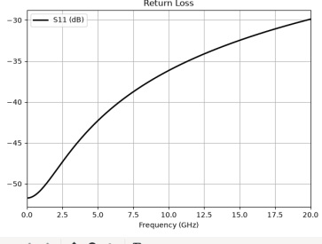
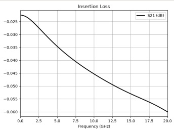
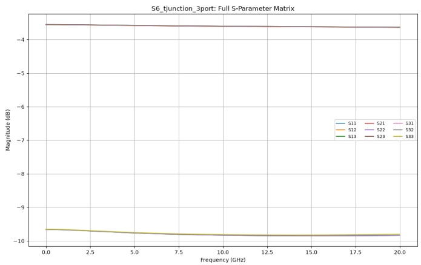

# RFIC Characterization with IHP SG13G2

**Karlsruhe Institute of Technology (KIT) | Summer 2026**

**SiGe HBT characterization · S-parameters and noise · KLayout and openEMS · DRC/LVS**

This repository contains the circuit simulation and EM layout work from my research internship at KIT. I used the IHP SG13G2 OpenPDK to study the `npn13G2` HBT, then moved to passive transmission-line structures and layout verification.


## 1. SiGe HBT characterization

I started with DC sweeps to examine the transistor's operating regions, followed by AC and RF simulations in Xschem and Ngspice. The RF testbench uses 50 Ω ports and includes the following analyses:

- `S11`, `S21`, `S12`, and `S22`, including Smith-chart interpretation.
- Noise figure (NF), minimum noise figure (NFmin), optimum source reflection coefficient (Sopt), and equivalent noise resistance (Rn).
- Stability using Rollett's `K` factor and `|Δ|`, with maximum stable gain where appropriate.
- The impact of bias, input/output matching, and frequency on transistor behavior.

The original report shows roughly **20 dB forward transmission** over part of the studied range, while input/output matching remained poor. A noise figure near **1.5 dB** and `NFmin` near **0.5 dB** were reported in the lower-frequency region. `K < 1` over part of the sweep meant unconditional stability could not be assumed.

These are **simulation results**, not silicon measurements. They depend on the model, bias point, and frequency.

## 2. EM simulation and physical verification

I continued with KLayout, AppCSXCAD and openEMS, comparing a reference GSG line with custom on-chip structures.

| Structure | Work and results documented in the internship report |
| --- | --- |
| Reference GSG line | Used an existing example to check the EM flow; at 10 GHz, `S11 = −35.00 dB`, `S21 = −0.016 dB` |
| Custom Metal1–TopMetal2 line | 200 µm × 20 µm signal strip above a 240 µm × 200 µm ground plane; at 10 GHz, `S11 ≈ −36 dB`, `S21 ≈ −0.045 dB` |
| Three-port T-junction | Adapted a general N-port workflow to calculate the S-matrix and examine passivity and reciprocity |
| Single `npn13G2` test layout | Ran the documented SG13G2 DRC/LVS flow; report shows zero DRC violations and a matching LVS result |

The reference line was not my original layout. The original custom-line report documents Port-1 excitation; a complete independent two-port matrix would also require driving Port 2.

### Selected figures from the report

| Custom transmission line | Three-port T-junction | HBT layout |
| :---: | :---: | :---: |
|  |  |  |

| Custom line S11 | Custom line S21 | T-junction S-parameters |
| :---: | :---: | :---: |
|  |  |  |

The [full report](docs/Ceyla_RFIC_IEEE_Two_Column_Report.pdf) contains the remaining figures, simulation setups and DRC/LVS screenshots.

## 3. Project files

- [Internship report (PDF)](docs/Ceyla_RFIC_IEEE_Two_Column_Report.pdf) — HBT simulations, EM results and layout verification.
- [Open-source EDA setup guide (PDF)](docs/IIC_OSIC_TOOLS_Installation_and_Localhost_Guide.pdf) — Docker, IIC-OSIC-TOOLS and local environment setup.
- [HBT RF testbench](simulations/S1_npn13G2_RF_Biased_Testbench.spice) — one preserved Ngspice configuration.
- [Simulation methodology](docs/methodology.md) and [results](docs/results.md).
- [Reproduction notes](docs/reproducibility.md) — tools, missing inputs and a bias-point difference between the saved netlist and some report figures.
- [Touchstone analysis and GDS examples](docs/reconstructed-tools.md) — later utilities for exploring the documented flow.
- [Evidence table](docs/verification-matrix.md) — which result belongs to the internship report and which file is an example.

## 4. Running the analysis tools

The repository includes a Touchstone parser, basic RF checks, a GDS geometry generator and an N-port simulation runner.

```bash
python -m pip install -r requirements.txt
python scripts/analyze_touchstone.py examples/synthetic_two_port_TEST_ONLY.s2p --freq-ghz 10
python -m unittest discover -s tests -v
```

The included `.s2p` file is **synthetic test data**, useful for trying the parser. It is not a recreated version of the internship sweep.

Generate the example GDS files with:

```bash
python -m pip install gdstk
python scripts/generate_gds_examples.py --out-dir generated_gds
python scripts/run_auto_nport_interactive.py generated_gds/metal_2port_reconstructed.gds --dry-run
```

The geometry examples were created from the available report dimensions after the internship; they are **not original recovered GDS files**. A complete EM run still needs a verified process stack, geometry importer and openEMS driver. The `--dry-run` option checks port-marker discovery without claiming an EM simulation result.

## 5. Reproducibility notes

The saved RF netlist uses `V2 = 0.85 V` and `V4 = 1.2 V`, while several figures in the report use `0.8 V` and `2.0 V`. These configurations should not be compared without restoring the matching biases.

The original EM project folders, GDS files and exported Touchstone sweeps are not all archived here. The report is the main record of the internship results; the Python utilities and sample GDS files support further exploration rather than replace those originals.

**Tools used:** IHP SG13G2 OpenPDK, Xschem, Ngspice, KLayout, AppCSXCAD, openEMS, IIC-OSIC-TOOLS, Docker, Ubuntu, Python.
